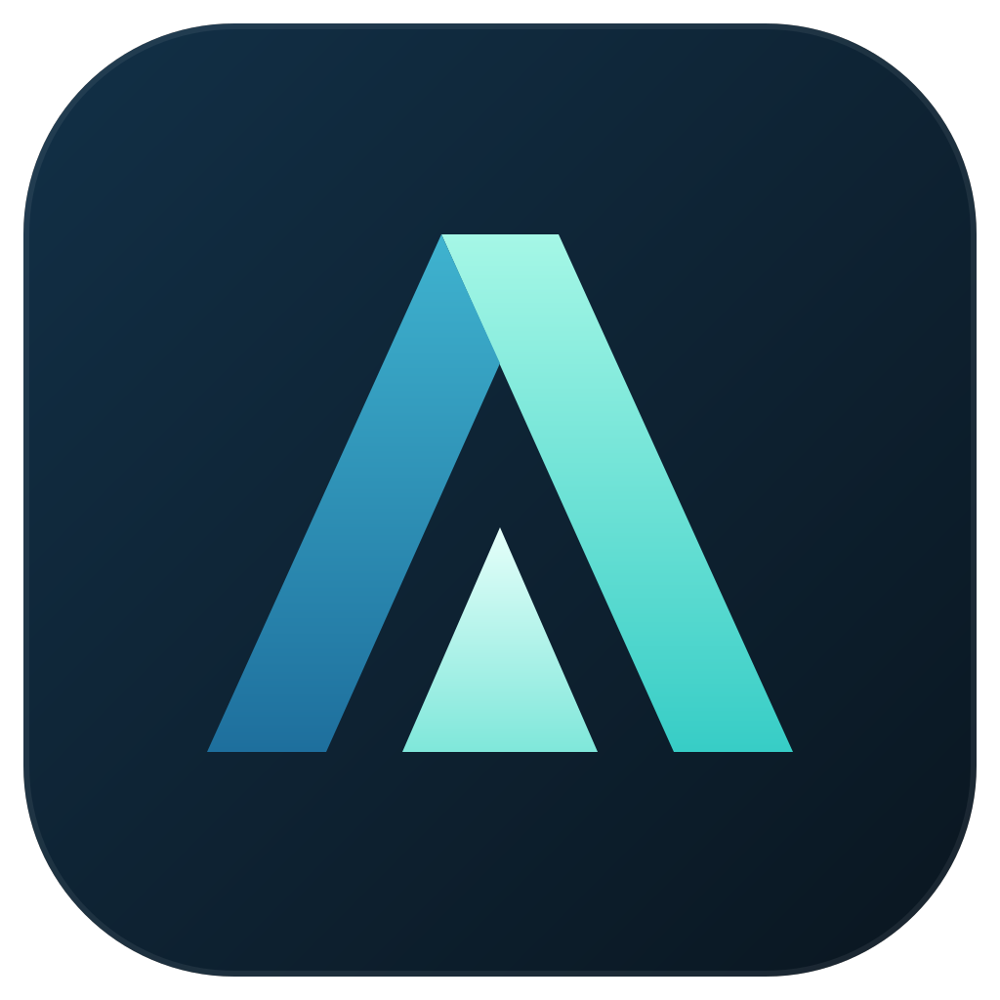

<p align="center"></p>

<h1 align="center">Altherra Launcher</h1>

<p align="center">Лаунчер Minecraft-сервера <b>Altherra</b>. Швидкий, нативний, без зайвого.</p>

---

- **Ліцензія й без неї.** Вхід через Microsoft або просто за ніком; перемикання між акаунтами в один клік.
- **Ставить усе сам.** Java, Minecraft, Fabric і моди сервера: нічого не треба шукати й копіювати руками.
- **Завжди актуальна збірка.** Коли на сервері оновлюються моди, лаунчер підтягне зміни перед наступним запуском.
- **Легкий.** Один файл на Rust + [Slint](https://slint.dev) без браузера всередині: відкривається миттєво й майже не їсть памʼяті.
- **Надійний.** Кожен файл перевіряється за контрольною сумою, а невдалі завантаження повторюються. Лаунчер ходить в інтернет лише через HTTPS і не дає серверу збірки виконати щось поза грою.

## Завантажити

Останній реліз — на сторінці [Releases](../../releases/latest):

| Система | Інсталятор |
|---|---|
| Windows 10/11 | `Altherra-Setup-windows-x64.exe` |
| Linux (glibc і musl) | `Altherra-Setup-linux-x64.run` — запуск: `sh Altherra-Setup-linux-x64.run` |
| macOS 11+ (Apple Silicon та Intel) | `Altherra-macos.zip` |

Встановлений лаунчер оновлюється сам: коли виходить нова версія, зверху зʼявляється кнопка «Оновити». Оновлення підписані ключем Ed25519, тож підмінений файл лаунчер не встановить.

## Збирання

```bash
cargo build --release
```

---

Не є офіційним продуктом Minecraft. Не схвалено Mojang чи Microsoft і не повʼязано з ними. Шрифти Unbounded, Manrope і JetBrains Mono — за ліцензією SIL OFL 1.1 (`ui/fonts`). Made with Slint.
